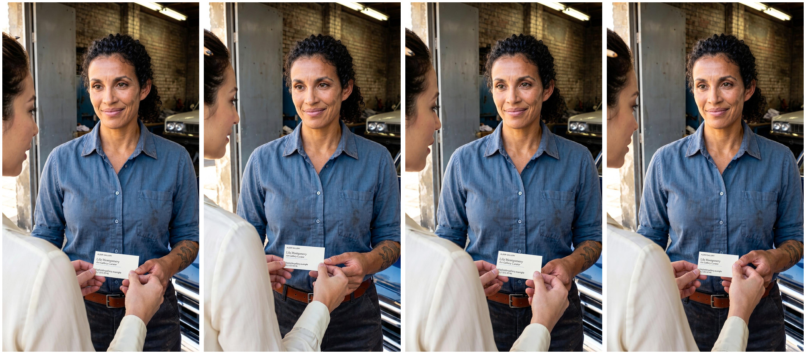
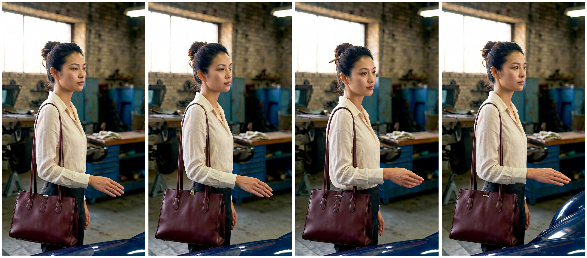
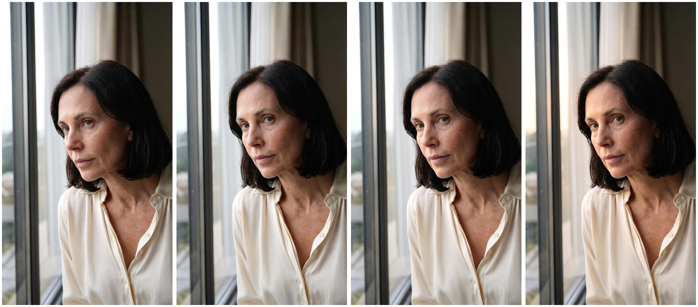

# MiniMax-H3-Image on FP8 weights: tested, then put in production

26 Nov 2026 (27 Nov 03:50 to 04:30 UTC). Follows
[what one keyframe draw costs](h3-image-per-draw-cost.md), which found the image server
out of GPU memory.

## Summary

The H3 image server now runs with its transformer and text encoder in FP8. It holds about
33 GB a card instead of about 52, so the card it shares with other teams' containers has
18 GB to spare on the heaviest request instead of running out.

- **It fixes the failures.** Nine references at 1536x2720, which the server could not
  hold, now peak at 63.4 GB of the card's 81.5 GB.
- **It is no slower.** A real six-reference keyframe takes 9.3 s, against 9.7 s before.
- **The pictures change a little.** The same request and seed gives the same scene, people
  and wardrobe, with small differences in pose and detail, as a different seed would. No
  loss of quality was seen side by side at half size. Likeness was not scored.
- **A whole server now fits on one card.** It draws at about two thirds of a pair's speed.
  Three or four image servers are possible without a third pair of cards.
- **The community FP8 file was not needed.** SGLang cannot load Unsloth's file, and
  quantizes the original weights itself when asked.

Nothing in the app changed. The keyframe size (1024x1824) and the six-reference limit set
on 26 Nov are still on; both can now be lifted.

## Why FP8, and why not the Unsloth file

A smaller H3-Image was looked for on Hugging Face. MiniMax publishes one image checkpoint
(BF16, 68.65 GB) and a prompt expander, no smaller model. The community has quantized
copies: GGUF files for ComfyUI and stable-diffusion.cpp, and
[`unsloth/MiniMax-H3-Image-FP8`](https://huggingface.co/unsloth/MiniMax-H3-Image-FP8), an
FP8 and an INT8 file of the transformer, 18.9 GB each.

SGLang, which serves the model here, cannot load that file. Read from the file's header
and from SGLang's source in the running pod (`6be0d75ae0`):

- The file stores each weight in torchao's layout: a `..._weight_qdata` tensor and a
  per-row `..._weight_scale`, described in the header's metadata. SGLang's loader has no
  code for that layout and torchao is not in the image.
- SGLang reads quantized checkpoints in ComfyUI's layout or its own, and its H3-Image
  pipeline accepts neither: only quantization done at load.
- The rest of the file would have mapped: it uses the diffusers key names SGLang already
  translates.

What SGLang does accept for H3-Image is `--quantization=fp8` for the transformer and
`--component-quantizations.text_encoder=fp8` for the text encoder, both made from the BF16
checkpoint already on disk. Unsloth's own card says FP8 made at load scores about the same
as their file (LPIPS 0.266 against 0.255, both measured against BF16), so nothing is lost
by not using it. Their better scheme, INT8-ConvRot (0.140), is refused by this SGLang
build for H3-Image.

## The test

**Where.** GPUs 3 and 4 of h100-087, with the Ref2VA video server scaled to zero for the
length of it (03:53 to 04:13 UTC; it had been idle since 09:39 the day before). A
Deployment with its own label, so it never joined the image Service; deleted afterwards.
The production image, with three sets of flags in turn. Each card also held its usual
`asr-distil` worker (7.7 GB).

| | Flags added to production's |
| --- | --- |
| A | `--quantization=fp8` |
| B | A, and `--component-quantizations.text_encoder=fp8` |
| C | B, on one card: `--num-gpus=1 --tp-size=1` |

**What was sent.** Twelve requests to each server after a warm-up draw, and nine of them
to the BF16 production server for comparison (the three heaviest would have stopped it):

- two real keyframes replayed from the episode run, with their prompts, seeds and
  references as the app sends them (5 and 6 references, 1024x1824);
- one fixed prompt without references at 1024x1824 (two seeds) and 1536x2720;
- the same picture as 1, 3, 6 (two seeds) and 9 references at 1024x1824;
- 6 and 9 references at 1536x2720, references at that size too.

Measured as before: the server's own inference time and PyTorch peak, and `nvidia-smi`
every 100 ms. The scripts, the test manifest and every result are in
[`h3-image-fp8/`](h3-image-fp8/).

## Results

### Memory

| Server | Text encoder | Transformer | PyTorch at rest, a card | The process at rest, a card | PyTorch peak, 9 references at 1536x2720 |
| --- | --- | --- | --- | --- | --- |
| BF16, two cards (production before) | 24.84 GB | 19.88 GB | 48.4 GB | about 52 GB | does not fit GPU 2 |
| A: FP8 transformer, two cards | 24.84 GB | 10.54 GB | 39.5 GB | 44.5 GB | 45.3 GB |
| B: FP8 both, two cards | 13.49 GB | 10.54 GB | 27.8 GB | 32.8 GB | 33.7 GB |
| C: FP8 both, one card | 25.40 GB | 19.92 GB | 50.3 GB | 52.1 GB | 67.4 GB |

On two cards each card holds half of each model, so one card holding both halves (C) is
about the size of one BF16 card. All three loaded in about 2 min 20 s, as BF16 does.

### Time

Inference time for one draw, in seconds.

| Request | BF16 | A | B | C, one card |
| --- | --- | --- | --- | --- |
| No references, 1024x1824 | 1.3 | 1.1 | 1.0 | 1.6 |
| No references, 1536x2720 | 1.1 | 0.9 | 0.8 | 1.4 |
| 1 reference | 2.9 | 2.5 | 2.5 | 3.7 |
| 3 references | 5.5 | 4.6 | 4.5 | 7.3 |
| 6 references | 11.4 | 9.9 | 9.6 | 16.4 |
| Real keyframe, 5 references | 9.8 | 8.4 | 8.3 | 12.7 |
| Real keyframe, 6 references | 9.7 | 9.4 | 9.3 | 13.9 |
| 9 references | not run | 16.5 | 16.3 | 28.6 |
| 6 references, all at 1536x2720 | not run | 18.8 | 18.7 | 32.0 |
| 9 references, all at 1536x2720 | not run | 32.3 | 32.4 | 58.1 |

- **FP8 is slightly faster than BF16** on every request, by 4 to 25%. The BF16 numbers
  were taken while the episode run was drawing on the same server, so the gap may be
  smaller than it looks; FP8 is at least not slower.
- **The text encoder in FP8 changes nothing in time** (A against B).
- **One card takes about 1.5 times as long as two.** Two one-card servers therefore draw
  about 1.3 times as many pictures as one two-card server, and one failing does not stop
  the other.
- **References at 1536 px cost twice the time** of references at 1024 px: 18.7 s against
  9.6 s for six. This is the cost of going back to 1536x2720 keyframes.

### Pictures

The same request and seed on each server, left to right: BF16, A, B, C.

In all three, the people, wardrobe, set and props are the same across the four servers,
and the small print on the card stays readable. What moves is what moves between seeds:
the angle of a head, where a hand is, a bag's clasp, how far a car comes into frame. No
picture is softer or noisier than its BF16 neighbour at this size.

In numbers the pictures are far from identical: PSNR against BF16 runs from 16 to 39 dB
and SSIM from 0.81 to 0.98 over five requests and three servers. That measures the shift
in composition, not a loss of quality, and it means a keyframe redrawn today with an old
seed will not match the one drawn last week.

## Production

Variant B went to production: two flags in `gpu-infra`
(`clusters/h100-087/workloads/newsbreak-087/minimax-h3-still.yaml`, commit `079b364`),
applied 27 Nov 04:21 UTC, ready 04:23:51. The episode run was paused for the restart.

| GPU 2 | Before | Now |
| --- | --- | --- |
| In use at rest | 78.2 GB | 58.4 GB |
| Peak, six references at 1024x1824 | 80.8 GB | 61.5 GB |
| Peak, nine references at 1536x2720 | out of memory | 63.4 GB |
| Free at that peak | none | 18.1 GB |

The same requests were run again on the production pod: all finished, with the times
of variant B (a real six-reference keyframe in 9.3 s), and the pod did not restart.

To go back: remove the two flags and apply (about two and a half minutes down). BF16 only
fits again once GPU 2 is given back.

## What this opens

- **1536x2720 keyframes and nine references fit again.** Remove
  `DRAMA_KEYFRAME_SHORT_EDGE=1024` from `.env` and set
  `DRAMA_KEYFRAME_MAX_REFERENCES=9` to return to both. The price is time: six references
  at 1536 px take 18.7 s a draw against 9.6 s.
- **More image servers.** A one-card server needs 52 to 67 GB. GPU 1 could hold one in
  place of its half of the pair, and GPUs 3 and 4 one each while the video server is
  away; GPU 2 could not while the other teams' containers are on it. This needs a one-card GPU resource in `gpu-infra`, and the app's
  single GPU lock made a limit of as many draws as there are servers.
- **The image and video servers still cannot share a pair.** Variant B (33 GB) beside the
  video server (39 GB) and an `asr-distil` worker (8 GB) leaves a card about 1 GB.

## Limits

- **Quality was judged by eye, at half size, on three requests.** No likeness score, no
  full-size inspection, no text-heavy or crowded shot. The vision check in the keyframe
  flow will see every draw from now on; its pass rate before and after is the real test
  and has not been compared.
- **One draw a request.** Times vary by about 10% between two draws of the same request.
- **The BF16 baseline was not idle** (see Time).
- **The one-card server was run alone on its card.** Two of them on a pair, or one beside
  another team's containers, were not run.
- **INT8 was not tried**: this SGLang build refuses it for H3-Image.
