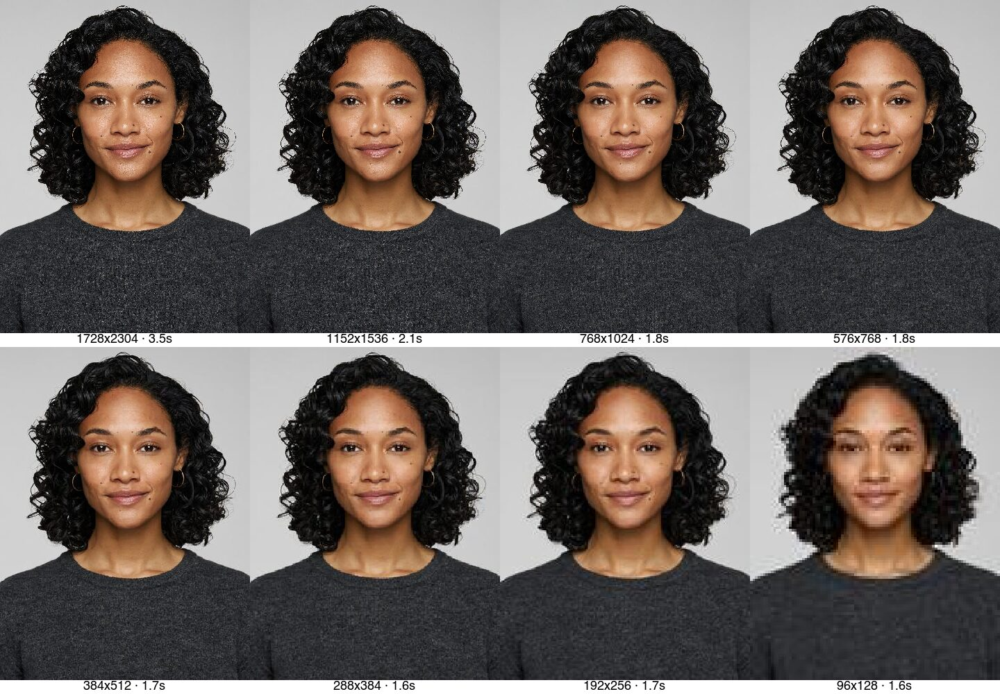
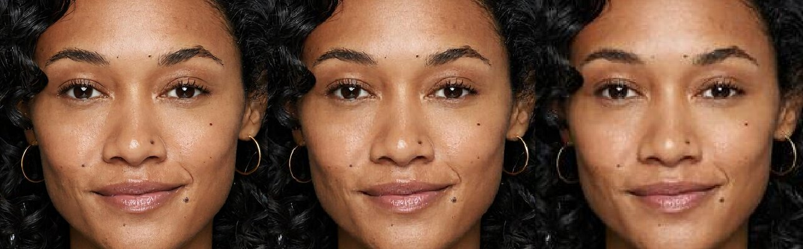

# MiniMax-H3-Image: the smallest size, and what size costs in time

20 Nov 2026. A measurement only: no app code was changed for this report.

## Summary

MiniMax's documents give no minimum size for H3 images: only that both sides are
multiples of 32, that the model is best at about 16 MP, and that about 1 MP "works for
drafts but is harsher". So one prompt was rendered at eight sizes, from the app's 2K size
down to 96x128, through the route the app uses (MCPHub's GPU route), and each call timed.

- **Every size rendered.** None was refused, down to 96x128 (0.01 MP), and each image came
  back exactly the size asked for.
- **Time has a floor of about 1.6 s a call.** Below about 1 MP, a smaller image is no
  faster: 768x1024 took 1.8 s, 96x128 took 1.6 s. Above it, time grows by about 0.55 s per
  megapixel: 1728x2304 (4 MP) took 3.5 s.
- **The same seed gives the same picture at every size:** pose, hair, sweater, earrings,
  light and backdrop match. Only detail changes.
- **Quality holds down to 768x1024**, softens at 384x512 (smooth, blotchy skin; stepped
  hair edges when enlarged), and is unusable at 96x128.
- **Small asked-for details drift at every size.** The prompt asked for one mole above the
  right corner of the upper lip; every size drew several moles, in places that move from
  size to size. Size doesn't fix this.

For the app: draft sizes save almost no time per image, because the app's drafts are
already at the floor; and 2K costs only about 2 s more than a draft.



## Why this was measured

The app draws its design pictures at a 2K size, or at a draft size when "Draft (fast)" is
chosen on the design board (`design/prompts.py`, `SIZES`). Its keyframes and image chats
always use 2K sizes (`shots/common.py`, `KEYFRAME_SIZES`; `experiment.py`, `SIZES`). Whether
smaller drafts would be faster, and what they would cost in quality, wasn't known.

| Picture | Draft | 2K |
| --- | --- | --- |
| Look, full body (9:16) | 576x1024 (0.59 MP) | 1536x2720 (4.2 MP) |
| Face (3:4) | 768x1024 (0.79 MP) | 1728x2304 (4.0 MP) |
| Set, wide view (4:3) | 1024x768 (0.79 MP) | 2304x1728 (4.0 MP) |
| Set plan, prop (1:1) | 1024x1024 (1.0 MP) | 2048x2048 (4.2 MP) |

## Method

- **Route:** `POST https://api.mcphub.com/api/v3/gpu-images/minimax-h3-image/generations`, the
  app's H3 route: MCPHub's GPU route to a self-hosted SGLang server, which renders the
  prompt as written (no prompt expander). Text to image; no reference pictures.
- **Prompt:** one casting photograph, written by the app's H3 rules
  (`.claude/skills/minimax-h3-image-prompt`):

  > A studio casting photograph of one woman in her early thirties, head and shoulders,
  > front-facing, looking straight into the camera with a calm, slight smile. She has warm
  > brown skin, dark brown eyes, shoulder-length black curly hair parted on the left, a small
  > mole above the right corner of her upper lip and thin gold hoop earrings. She wears a
  > plain charcoal crew-neck sweater. Soft key light from a large softbox at camera left, a
  > gentle fill from the right, even plain light-grey seamless backdrop. Natural skin texture,
  > sharp focus on the eyes. The image contains no text, letters or numbers.

- **Sizes:** eight 3:4 sizes, every side a multiple of 32: 1728x2304 (the app's 2K face),
  1152x1536, 768x1024 (the app's face draft), 576x768, 384x512, 288x384, 192x256 and 96x128.
- **Settings:** seed 7 for every size, JPEG output. Steps and guidance are fixed by the
  server.
- **Timing:** wall-clock time of each HTTP call, from the request to the whole response
  (the image comes back as base64 in the JSON body). One call at a time, largest first; no
  other user was waiting on the GPU, as far as could be seen.
- **Script:** [`h3-image-size-floor/render_sizes.py`](h3-image-size-floor/render_sizes.py);
  the raw timings are in [`h3-image-size-floor/times.json`](h3-image-size-floor/times.json).

## Results

### Time

| Size | Megapixels | Time | JPEG |
| --- | --- | --- | --- |
| 1728x2304 (app's 2K face) | 3.98 | **3.5 s** | 563 KB |
| 1152x1536 | 1.77 | 2.1 s | 280 KB |
| 768x1024 (app's face draft) | 0.79 | 1.8 s | 128 KB |
| 576x768 | 0.44 | 1.8 s | 71 KB |
| 384x512 | 0.20 | 1.7 s | 31 KB |
| 288x384 | 0.11 | 1.6 s | 18 KB |
| 192x256 | 0.05 | 1.7 s | 8 KB |
| 96x128 | 0.01 | 1.6 s | 3 KB |

The times fall into two parts:

- **A fixed cost of about 1.6 s a call**, whatever the size: the network, the queue,
  loading the prompt and the model's fixed steps. Below 1 MP, nearly all of a call is this.
- **About 0.55 s per megapixel above it.** A straight line through the three sizes at
  0.8 MP and above gives 1.3 s + 0.55 s per MP.

Carried on to the 16 MP sizes the skill calls best (for example 3552x4736), that line
gives about 10.5 s an image, in line with the skill's "about 8 to 14 s each". That size
wasn't rendered here.

### Picture

- **Composition doesn't depend on size.** With the same seed, all eight images show the
  same woman in the same pose, with the same curls, sweater, earrings, light and backdrop.
  A draft at a small size is a faithful preview of the 2K picture from the same seed.
- **1728x2304 and 1152x1536:** sharp eyes and lashes, natural skin texture, single hairs
  at the edges of the curls.
- **768x1024 (the app's face draft):** the face is still clean and the likeness holds; skin
  texture and lashes are a little softer.
- **576x768:** still a usable likeness at normal viewing size.
- **384x512:** at its own size it looks fine; enlarged, the skin turns smooth and blotchy,
  and hair edges show steps.
- **288x384 and 192x256:** a thumbnail. Face and hair read, but no detail survives
  enlargement.
- **96x128:** blocks of colour; the face is mush.



### Asked-for details

The prompt asked for **one** small mole above the right corner of the upper lip. No size
drew it as asked: every image has several moles (on the forehead, the cheeks, near the
mouth and chin), and their places change from one size to the next even with the same
seed. The earrings, the parting and the sweater held at every size above 96x128.

So a small identifying mark is not reliable in an H3 picture at any size. It needs
checking (the app's keyframe check compares a draw with its design pictures), or fixing in
an edit with the face as a reference.

## What this means for the app

1. **The draft sizes save almost no time per image.** The app's drafts (0.6 to 1 MP) take
   1.8 s against 3.5 s at 2K: about 2 s saved a picture. That adds up only over a large
   Explore batch (for example 4 takes x 3 draws for each of 20 items: 240 images, about
   8 minutes saved). Smaller drafts than today's would save nothing.
2. **Drafts below about 768 px on the long side aren't worth it:** they are no faster and
   visibly worse.
3. **A draft is a true preview.** With the same seed, the 2K picture is the draft's
   picture with more detail. So "draw small, pick, redraw the pick at 2K with its seed" is
   safe, if that is ever wanted.
4. **16 MP would cost about 3 times the 2K time** (about 10.5 s against 3.5 s) for the
   size the skill calls best. Whether it looks better than 2K for our pictures wasn't
   tested here.

## Limits

- **One run per size.** A shared GPU varies; differences of 0.1 to 0.2 s mean nothing.
- **No queue.** On a busy GPU, each call also waits for the images ahead of it; that wait
  doesn't depend on size and isn't in these times.
- **Text to image only.** Edits with reference pictures (looks, set states, keyframes)
  upload pictures and may cost more per call; not measured.
- **One prompt, one subject, one seed.** A face shows loss of detail early; a wide set view
  may hold up better or worse at small sizes.
- **16 MP sizes weren't rendered.** Their time is an estimate from the line above.
- **Quality was judged by eye**, not by the app's keyframe check or any metric.

## Reproducing it

From the repo root, with `MCPHUB_KEY` in `.env` (eight real calls, one at a time):

```bash
.venv/bin/python reports/h3-image-size-floor/render_sizes.py /tmp/h3sizes
```

It writes `<size>.jpg` for each size and `times.json`.
